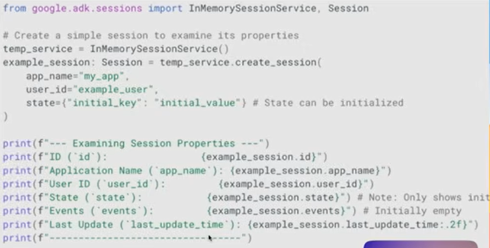

### SESSION
a session inside an adk is nothing more than really two major peices of information
- state (where we can store any info in dict/keys-vals)
- events = it is essentially a list of info which happens b/w us and the agents (
    - a msg history b/w us and agents (M)
    - tool calling (T)
    - agent responses (A)
    )
- additional info:  
    id (session_id)  
    app_name  
    user_id  
    last_update_time

session = a statefull chat history

diff ways to store sessions
1. InMemorySessionService
    - where all the convo histories with each agent are saved in memory (as soon as the app is closed/gone we'll lose this memory)
2. DatabaseSessionService
    - every convo we have with our agent is stored in a database
3. VertexAISessionService
    - saving sessions in vertex ai(cloud)

### RUNNER
it is a collection of 2 pieces of information (AGENTS & SESSIONS) needed to generate responses  
here session(2) collects all the context of the user and gives it to agents and from there, one agent is selected to do the work

NOTE: in this project we are keeping the .env in the root of the project cuz we are creating all(memory + session + etc) on our own
before we used to let adk load the vars (we used to use `adk web`) but here we hv to do it by ourselves